# APAAR Nexus

### Student Data Management & Verification Platform for AICTE
**A working prototype for Smart India Hackathon, Problem Statement PS 26263.**

> **Prototype Notice:** All institutions, students, APAAR references, credentials, and risk cases in this project are synthetic. This project is not connected to AICTE, APAAR, UIDAI, DigiLocker, or any government production system. APAAR validation is a format check plus a clearly labelled mock adapter. The built-in Flask server is for local development only.

[](#)
[](#)
[](#)
[](#)
[](#)
[](#)

---

## Table of Contents

- [What it does](#what-it-does)
- [Tech stack](#tech-stack)
- [Architecture](#architecture)
- [Design decisions](#design-decisions)
- [Quick start (Windows 11, PowerShell)](#quick-start-windows-11-powershell)
- [How to run tests](#how-to-run-tests)
- [Demo accounts (Development only)](#demo-accounts-development-only)
- [Demo scenario (Synthetic)](#demo-scenario-synthetic)
- [How the Seat Ledger works](#how-the-seat-ledger-works)
- [How the Risk Engine works](#how-the-risk-engine-works)
- [How credentials and sharing work](#how-credentials-and-sharing-work)
- [CSV format](#csv-format)
- [Project structure](#project-structure)
- [API overview](#api-overview)
- [Security highlights](#security-highlights)
- [Known limitations](#known-limitations)
- [Roadmap](#roadmap)
- [Contributing and workflow](#contributing-and-workflow)
- [FAQ](#faq)
- [Team](#team)
- [License](#license)

---

## What it does

APAAR Nexus lets AICTE-approved institutions submit, validate, monitor, and verify student-level academic records, built around three core pillars:

| Pillar | Feature | In plain words |
|---|---|---|
| **Prevent** | Dynamic Seat Ledger | The backend blocks admissions beyond approved intake. Regular and supernumerary seats are tracked separately, with category-eligibility rules. |
| **Detect** | Identity Graph + Explainable Risk Engine | Finds duplicate or conflicting identities across institutions, explains every link, and scores cases with transparent rules. Humans decide the outcome. |
| **Prove** | Privacy-Preserving Academic Passport | Ed25519-signed credentials, QR verification, and student-controlled, time-limited sharing of selected claims only. |

### Feature List
- **Role-based access** (AICTE admin, institution admin, student, employer/verifier, auditor) enforced on the server.
- **Institution-level data isolation** using server-side query scoping (`scope_query`).
- **Manual student entry and CSV upload** (preview, row-level errors, downloadable error report, idempotent imports).
- **Mock APAAR validation adapter** (format check only; no invented official algorithm).
- **Seat ledger** with 80% / 90% / 100% capacity warnings, admission pre-check, rejected-admission log, concurrency-safe last-seat handling.
- **Identity graph (Cytoscape.js)** where every edge carries a human-readable explanation.
- **Explainable risk engine** (configurable weights, deduplicated events, capped at 100, bands Low / Medium / High / Critical).
- **Case workflow**: Under Review, Request Clarification, Confirm Data Error, Dismiss False Positive, Resolve (all persisted and audited).
- **Signed credentials with QR verification**: Verified / Invalid / Revoked / Expired, decided by live backend checks.
- **Consent-based sharing** with opaque tokens, expiry (24h / 72h / 7 days), revocation, and selective disclosure.
- **Governance and institution dashboards (Chart.js)**, regulatory reports (CSV), and append-only audit logs.

---

## Tech stack

| Layer | Technology |
|---|---|
| **Frontend** | HTML5, CSS3, vanilla JavaScript (ES6+), Chart.js, Cytoscape.js (both vendored, works offline) |
| **Backend** | Python 3.11+, Flask, Flask-SQLAlchemy, Flask-Login, Flask-WTF (CSRF), Pydantic |
| **Database** | SQLite via SQLAlchemy ORM |
| **Libraries** | RapidFuzz (name similarity), cryptography (Ed25519), qrcode (server-side QR), Pandas (CSV), pytest, python-dotenv |

*No Node.js, no npm, no frontend framework, no build step.*

---

## Architecture

APAAR Nexus is a server-rendered monolith: Flask serves Jinja2 pages, and small vanilla-JS files call a JSON API on the same server. There is no separate frontend build, message queue or external service, which keeps the prototype easy to run, test, and demo on a single Windows laptop.

### 1. System Context

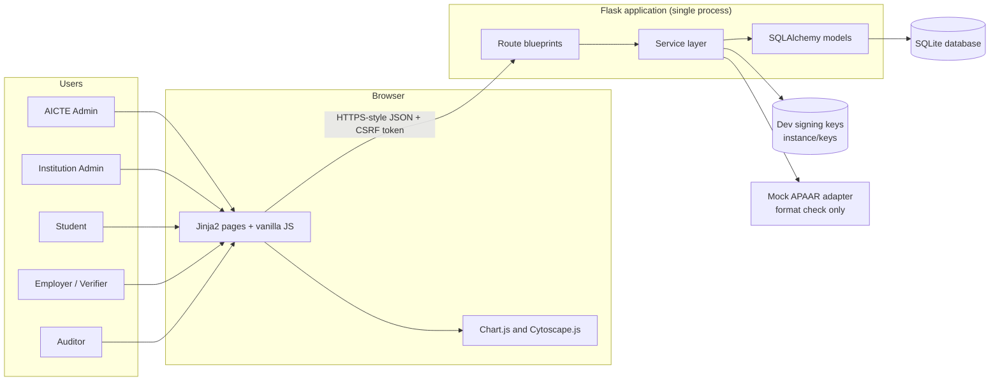

The mock adapter and the development key store are the only "external" pieces, and both are local to the project. Nothing calls AICTE, APAAR, UIDAI, or DigiLocker.

### 2. Layered Design

| Layer | Folder | Responsibility | Must not |
|---|---|---|---|
| **Presentation** | `templates/`, `static/` | Pages, tables, charts, forms, toasts | Contain business rules or trust role checks |
| **Routes** | `routes/` | Authenticate, authorise, validate input, call a service, return JSON envelope | Hold business logic or build SQL |
| **Services** | `services/` | All business rules: seat ledger, validation, CSV, identity resolution, risk, credentials, sharing, audit | Know about HTTP requests or HTML |
| **Data** | `models/` | SQLAlchemy models, constraints, indexes | Contain workflows |
| **Cross-cutting** | `services/authz.py`, `services/audit_service.py`, `config.py` | Role and institution scoping, audit trail, configuration | Be bypassed by a route |

### 3. Module Map: Prevent, Detect, Prove

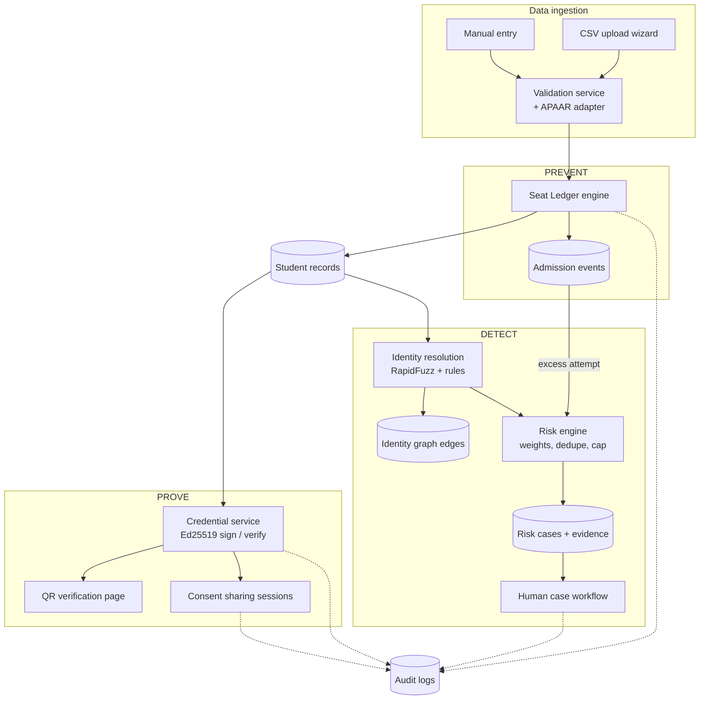

Solid arrows are data flow. Dotted arrows are audit writes. Risk cases never feed back into student records or credentials automatically: a human must act through the workflow.

### 4. Request Lifecycle

Every browser action follows the same path, so security checks cannot be skipped by a single page.

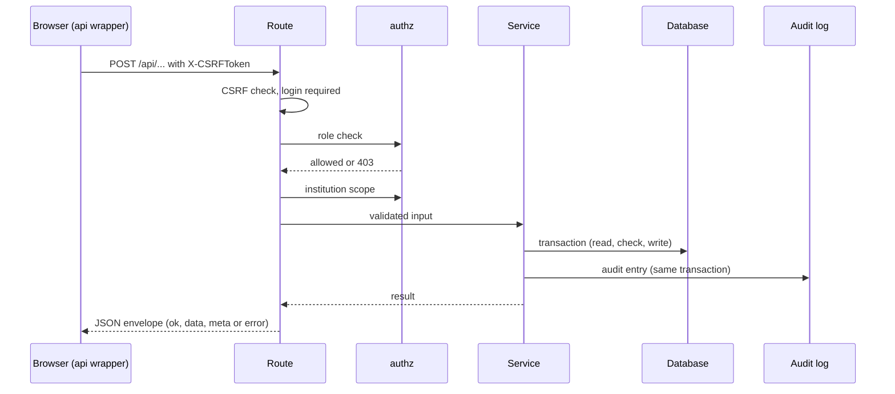

### 5. Key Flows

#### Admission with Seat Protection (Prevent)
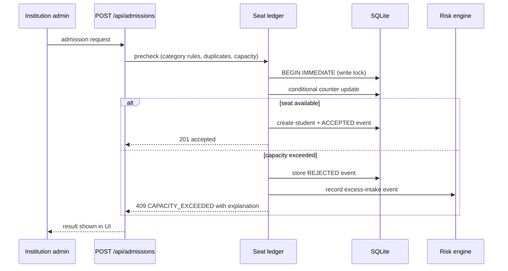

#### CSV Import (Idempotent)
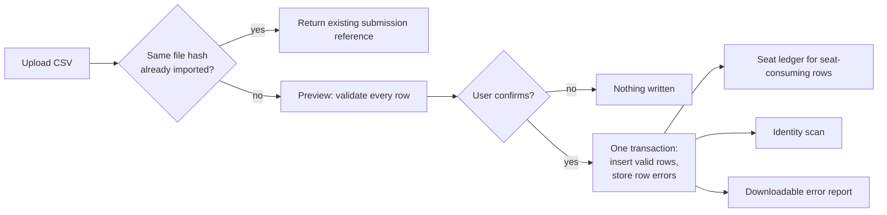

#### Credential Issue, QR Verify, Revoke (Prove)
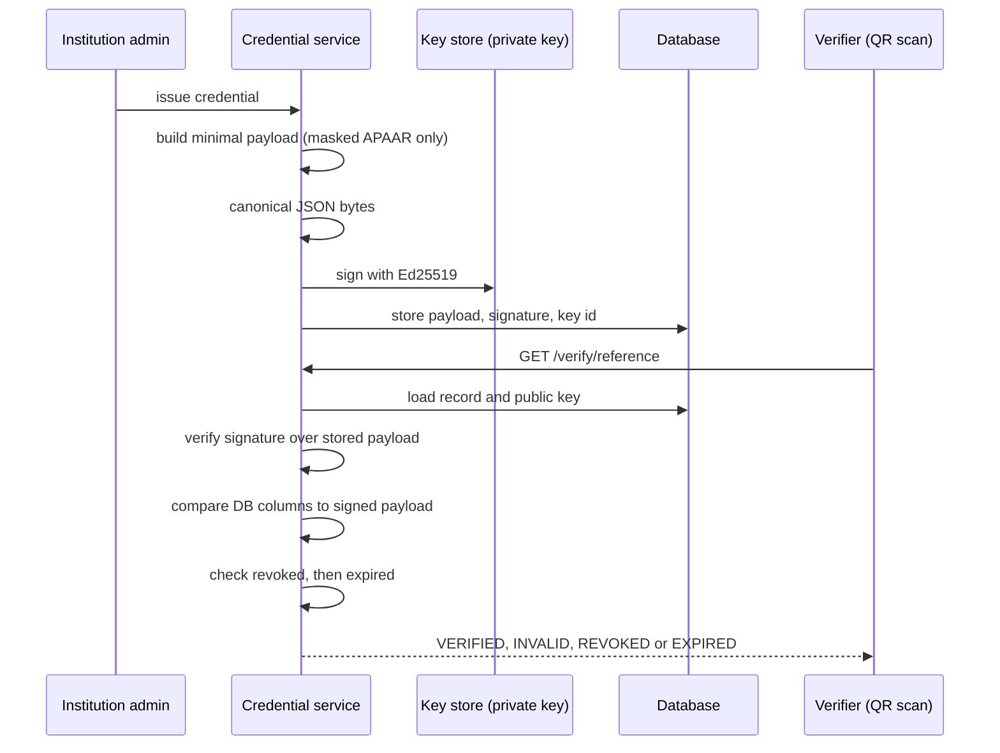

#### Consent-Based Sharing
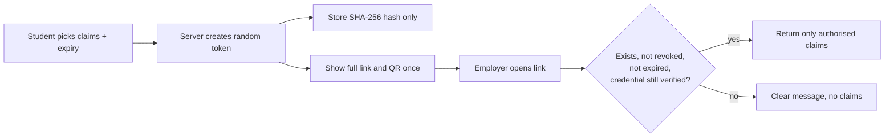

### 6. Data Model Overview

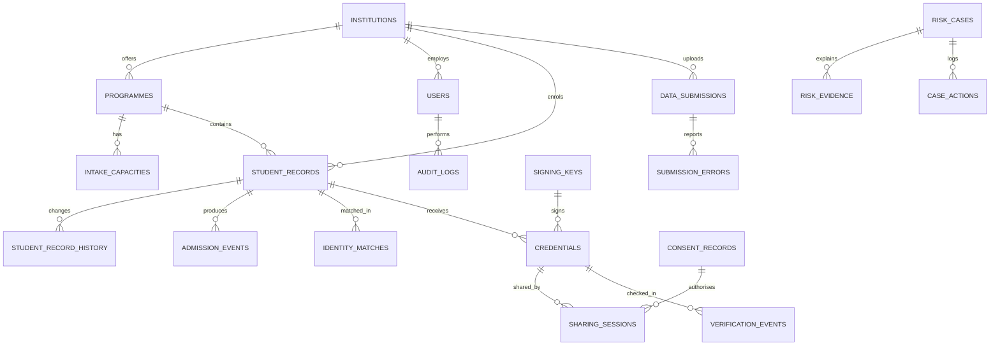

Primary keys are UUID strings. APAAR is stored as an external identifier column (indexed, never unique, never a primary key). Contact and fee-payer references are indexed but deliberately not unique. See [docs/DB_SCHEMA.md](docs/DB_SCHEMA.md) for every table and field.

### 7. Trust Boundaries and Security Architecture

| Boundary | Control |
|---|---|
| **Browser to server** | CSRF token on every mutating call, HttpOnly SameSite session cookie |
| **Role to feature** | Server-side role decorators on every route; sidebar is only cosmetic |
| **Institution to institution** | `scope_query` on every institution-scoped query; tested with multiple institution admins |
| **Upload to database** | `.csv` only, size and row limits, validation of every row, CSV-injection neutralised |
| **Backend to key material** | Private key stays in the key store on the backend; only public-key metadata is in the database and APIs |
| **Public to private data** | Only two public GET routes (`/verify/<reference>`, `/public/verify/<token>`), read-only, no-store, rate-limited, minimal disclosure |
| **Everything to audit** | Append-only audit log written in the same transaction as the action |

### 8. Deployment View

| Environment | Setup |
|---|---|
| **Local demo (this prototype)** | Windows 11, Python venv, Flask development server, SQLite file in `instance/` |
| **Production path (not implemented)** | WSGI server behind a reverse proxy with TLS, managed database, secrets manager, HSM/KMS for signing keys, central logging and monitoring, real APAAR / institution integrations |

---

## Design decisions

| Decision | Why |
|---|---|
| **APAAR is an external identifier, not a primary key** | Real-world identifiers can be wrong, missing or duplicated; the system must be able to store and investigate bad data rather than crash on it |
| **Shared phone or fee-payer references are signals, not proof** | Siblings and sponsors legitimately share them; treating them as duplicates would create false accusations |
| **Risk scores never trigger automatic action** | A score is evidence for a reviewer, not a verdict; credential revocation and case closure need an authorised human |
| **Rules-based, deterministic risk engine** | Every point of a score can be explained in plain words, which matters for a regulator |
| **Regular and supernumerary seats are separate pools** | Mixing them would hide real over-admission |
| **Capacity enforced in the backend with a write lock and conditional counter update** | Two simultaneous requests cannot both take the final seat; the browser cannot bypass it |
| **Ed25519 signatures over canonical JSON** | Small, fast, widely supported, and easy to verify; tampering with either the payload or the database columns is detected |
| **QR links to a real backend route** | The result (Verified / Invalid / Revoked / Expired) comes from live server checks, not a hard-coded badge |
| **Only a hash of each sharing token is stored** | A database leak does not expose working links |
| **Masked APAAR by default** | Privacy by default; full values are only revealed to authorised roles and the reveal is audited |
| **Server-side QR and vendored JS libraries** | Fewer dependencies, no CDN, works offline during a demo |
| **Plain HTML, CSS and vanilla JS** | Simple, auditable, no build step, quick for a two-person team |
| **Mock APAAR adapter clearly labelled** | We do not invent an official validation algorithm or claim a government integration |

---

## Quick start (Windows 11, PowerShell)

```powershell
git clone https://github.com/codingyash9-bit/SIH_2026.git
cd SIH_2026
python -m venv .venv
.\.venv\Scripts\Activate.ps1
pip install -r requirements.txt
copy .env.example .env
python seed.py --reset
python app.py
```

Open `http://127.0.0.1:5000`

If PowerShell blocks the activation script:
```powershell
Set-ExecutionPolicy -Scope CurrentUser -ExecutionPolicy RemoteSigned
```

Edit `.env` before running if you want a different `SECRET_KEY` or demo password.

**Run the tests:**
```powershell
pytest -q
```

**Reset the demo data:**
```powershell
python seed.py --reset
```
*(Admins can also reset from the Policies page when `ALLOW_DEMO_RESET=true`.)*

---

## How to run tests

All tests execute against a fast in-memory SQLite database using `pytest`:

```powershell
# Run the complete test suite quietly
pytest -q

# Run without random ordering (if pytest-randomly is installed)
pytest -q -p no:randomly

# Run specific test modules
pytest tests/test_auth.py -q
pytest tests/test_students.py -q
pytest tests/test_csv.py -q
pytest tests/test_seat_ledger.py -q
pytest tests/test_envelope.py -q
```

---

## Demo accounts (Development only)

Password for every demo account: the value of `DEMO_PASSWORD` in `.env` (default `Demo@12345`). Demo accounts and the login-page hint are disabled in production configuration.

| Username | Role | What they can do |
|---|---|---|
| `aicte_admin` | AICTE Super Administrator | Cross-institution dashboards, policies, risk cases, reports |
| `vesit_admin` | Institution Administrator | Manage VESIT Demo Institute only: upload CSV, seat ledger, issue credentials |
| `pune_admin` | Institution Administrator | Pune demo institute only (used to show data isolation) |
| `student_demo` | Student | View passport, manage sharing sessions |
| `employer_demo` | Employer / Verifier | Verify credentials and shared links |
| `auditor_demo` | Regulatory Auditor | Read-only reports, cases, audit logs |

---

## Demo scenario (Synthetic)

**VESIT Demo Institute, B.Tech Information Technology, 2026-27:**
- Approved regular intake: 120, regular admissions: 116
- Authorised supernumerary capacity: 10, supernumerary admissions: 4
- Attempting a 121st regular admission is rejected by the backend with an explanation.

*These are synthetic figures and are not actual VESIT data.*

### 12-Step Walkthrough
1. Log in as `aicte_admin` and open the governance dashboard.
2. Log in as `vesit_admin`, upload `sample_data/students_demo_upload.csv` (valid rows, duplicates, bad APAAR formats, a conflicting enrolment).
3. Review validation results and download the error report.
4. Open the Seat Ledger and try to exceed regular intake; see the backend block it.
5. Open the Identity Graph, inspect a cross-institution conflict, and read the evidence and risk score.
6. Update the case status; see the persisted audit event.
7. Issue a signed credential from the Academic Passport.
8. Open its QR verification page: **Verified**.
9. Open the tampered and revoked demo credentials: **Invalid** and **Revoked**.
10. As `student_demo`, create a time-limited sharing link exposing only degree and award year.
11. Open the link in a private window: only the authorised claims appear.
12. Export a regulatory report.

A click-by-click script is in [docs/DEMO_SCRIPT.md](docs/DEMO_SCRIPT.md).

---

## How the Seat Ledger works

- Capacity is tracked per institution, programme, and academic year.
- Regular and supernumerary seats are separate pools. Seats are never borrowed between them.
- Category-eligibility rules (stored in the database, admin-configurable) decide which categories may use which pool. Default prototype rule: `OPEN`, `OBC`, `SC`, `ST`, `EWS` use regular seats; `NRI`, `OCI`, `FN` use supernumerary seats.
- Admissions go through a pre-check, then a transactional commit that re-checks capacity under a lock, so two simultaneous requests cannot take the final seat.
- Rejected attempts are stored in the admission history and feed the risk engine (excess-intake rule).

---

## How the Risk Engine works

The [Identity Graph](docs/screenshots/graph.png) links synthetic student,
institution and masked APAAR nodes. Solid links carry identity evidence;
shared contact and fee-payer links are investigation signals. Each edge has
an explanation in the inspector and in the text evidence view. A name match
alone never opens an identity case: the engine requires corroboration.

Prototype rules, not official AICTE policy. Weights are stored in system policies and can be changed.

| Rule | Points |
|---|---|
| Duplicate APAAR identity | 40 |
| Simultaneous enrolment in two institutions | 35 |
| Excess-intake violation | 30 |
| Duplicate institutional ID conflict | 25 |
| Missing or malformed APAAR reference | 20 |
| Similar name with a corroborating attribute | 15 |
| Conflicting academic data | 15 |
| Shared contact among multiple records (signal) | 10 |
| Shared fee-payer reference (signal) | 10 |

Scores are capped at 100. The same underlying event never counts twice.

| Score | Band |
|---|---|
| 0–29 | Low |
| 30–59 | Medium |
| 60–79 | High |
| 80–100 | Critical |

Shared contacts and fee-payer references are investigation signals, not proof of duplicate identity. The system never labels a student as fraudulent and never revokes a credential automatically. An authorised human must review every case.

---

## How credentials and sharing work

- Credentials are signed with **Ed25519** using the Python cryptography library. Private keys stay on the backend. Development keys are used in this prototype.
- Each credential contains only: credential ID, synthetic student ID, masked APAAR, institution, programme, award year, issue date, and key ID.
- The QR code links to a real Flask route (`/verify/<reference>`) that checks the stored record, signature, revocation, and expiry on the server.
- Students choose which claims to share and for how long. Links use high-entropy random tokens; only a SHA-256 hash of the token is stored; expiry and revocation are checked on every request.
- Full APAAR IDs, dates of birth, addresses, and contact details are never shared.
- This prototype does not implement zero-knowledge proofs or decentralised identity.

The four seeded references make each backend result reproducible:
`CRED-DEMO01` verified, `CRED-DEMO02` revoked, `CRED-DEMO03` expired and
`CRED-DEMO04` invalid because its stored payload was altered after signing.
Open `/verify-console` or `/verify/<reference>` to show them. The seed also
prints a demo-only 72-hour link with just degree authenticity and award year.
The four seeded login accounts do not include a student; the `/sharing` page
is available when an authenticated student account is provisioned outside the
fixed demo seed. The full token is returned once and only its hash is stored.

---

## CSV format

Download the template from the Upload page or use [sample_data/students.csv](sample_data/students.csv).

* **Required columns:** `institutional student ID`, `APAAR reference`, `student name`, `institution`, `programme`, `academic year`, `admission date`, `admission category`, `classification (REGULAR / SUPERNUMERARY)`, `NRI status`, `OCI status`, `Foreign National status`, `enrolment status`.
* **Optional columns:** `contact reference`, `fee-payer reference`.
* Re-uploading the same file does not create duplicate records (idempotent hash check).

---

## Project structure

```text
SIH_2026/
├── app.py
├── config.py
├── extensions.py
├── seed.py
├── seed_b.py
├── requirements.txt
├── .env.example
├── models/             # database models
├── routes/             # Flask blueprints (auth, institutions, students, admissions, identity, risk, credentials, sharing, dashboards, reports)
├── services/           # business logic (seat ledger, validation, CSV, identity resolution, risk engine, credentials, sharing, audit)
├── templates/          # Jinja2 pages
├── static/             # css/, js/, vendor/ (Chart.js, Cytoscape.js)
├── sample_data/        # students.csv, students_demo_upload.csv
├── docs/               # API.md, DB_SCHEMA.md, SECURITY.md, DEMO_SCRIPT.md
├── tests/              # pytest suite
├── AGENTS.md           # rules for AI coding agents and teammates
└── STEPS.md            # build plan and work split
```

---

## API overview

All endpoints return a consistent JSON envelope (`ok`, `data`, `meta` / `error`). Full reference: [docs/API.md](docs/API.md).

| Area | Endpoints |
|---|---|
| **Auth** | `POST /api/auth/login`, `POST /api/auth/logout`, `GET /api/auth/me` |
| **Institutions** | `GET/POST /api/institutions`, `GET/PATCH /api/institutions/<id>` |
| **Students** | `GET/POST /api/students`, `GET/PATCH /api/students/<id>`, `POST /api/students/import`, `GET /api/students/export` |
| **Seats & admissions** | `GET /api/seats/summary`, `GET /api/seats/ledger`, `POST /api/admissions/precheck`, `POST /api/admissions`, `GET /api/admissions/events` |
| **Identity & risk** | `POST /api/identity/scan`, `GET /api/identity/graph`, `GET /api/risk/cases`, `GET /api/risk/cases/<id>`, `POST /api/risk/cases/<id>/actions` |
| **Credentials** | `POST /api/credentials/issue`, `GET /api/credentials`, `GET /api/credentials/<id>`, `POST /api/credentials/<id>/revoke`, `GET /verify/<reference>` |
| **Sharing** | `POST/GET /api/sharing-sessions`, `POST /api/sharing-sessions/<id>/revoke`, `GET /public/verify/<token>` |
| **Dashboards & reports** | `GET /api/dashboard/governance`, `GET /api/dashboard/institution`, `GET /api/reports/enrolment`, `GET /api/reports/anomalies`, `GET /api/audit-logs` |

---

## Security highlights

- Server-enforced roles and institution-level isolation (`scope_query`).
- CSRF protection on browser requests, HttpOnly SameSite session cookies.
- Werkzeug password hashing; no plaintext passwords.
- Upload size, type, and row limits; CSV-injection neutralisation.
- APAAR masked by default everywhere (last four digits only).
- Private keys never exposed; sharing tokens stored as hashes only.
- Append-only audit trail for all mutating actions.

Details: [docs/SECURITY.md](docs/SECURITY.md).

---

## Known limitations

1. APAAR checks are format-only plus a deterministic mock; no real identity verification.
2. SQLite and the Flask development server are for local demonstration only.
3. Development signing keys are used; production needs HSM/KMS key management, rotation, and a public revocation/status service.
4. Login rate limiting is in-memory and resets on restart.
5. Risk rules are prototype heuristics, not official AICTE policy.
6. All data is synthetic.

### What Production Integration Would Need
Authorised APAAR/ABC and institutional data integrations, proper identity assurance, managed keys and certificate distribution, a production database and WSGI deployment, centralised logging and monitoring, formal privacy and legal review, and accessibility and security audits.

---

## Screenshots

These are captures of the running local app with synthetic data:

| Dashboard | Seat Ledger block | Identity Graph |
|:---:|:---:|:---:|
| 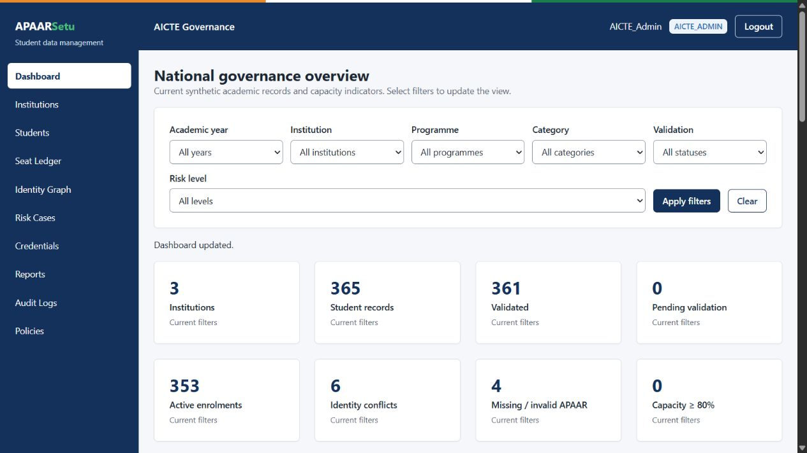 | 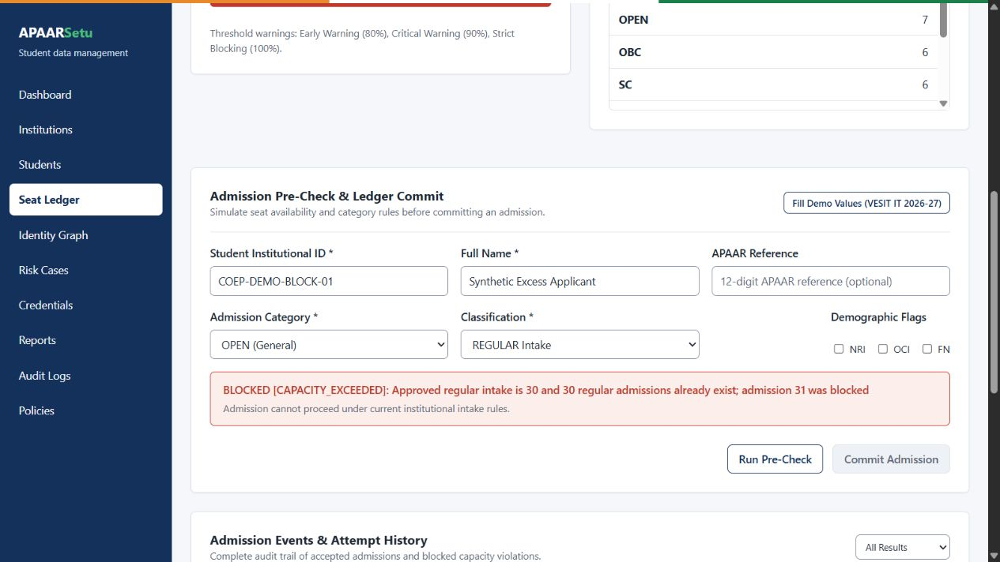 | 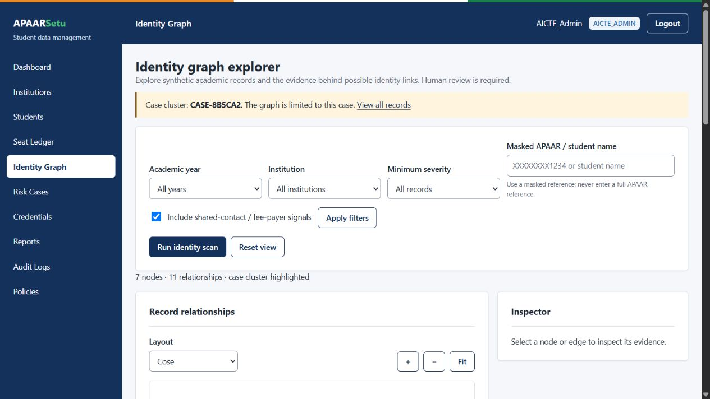 |

| Risk Case | Public verification |
|:---:|:---:|
| 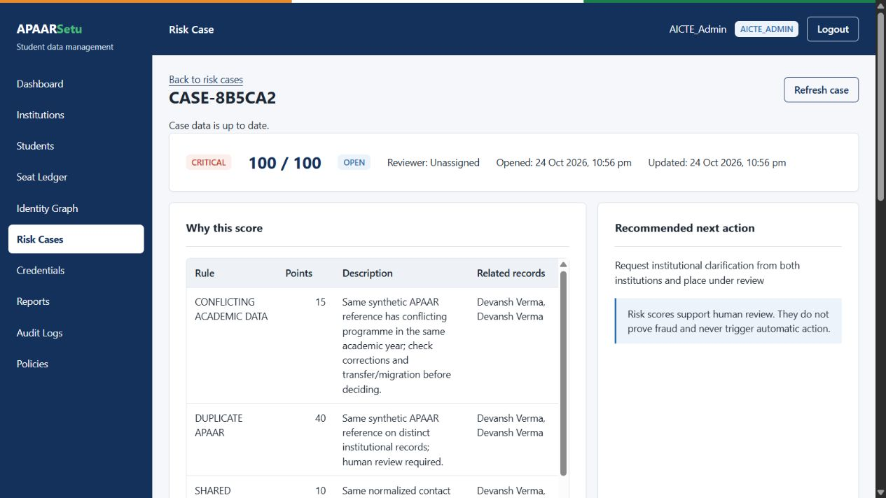 | 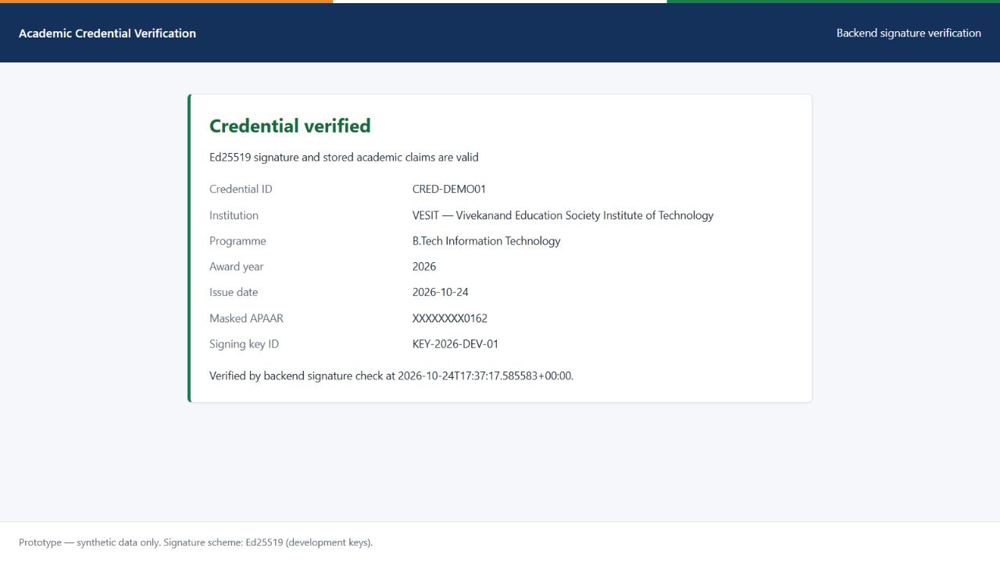 |

---

## Roadmap

### Prototype (This Repository)
- [x] Planned: Seat Ledger, identity graph, explainable risk engine, signed credentials, consent sharing, dashboards, audit trail
- [ ] Tick each item off as it ships; keep this list honest

### Beyond the Prototype (Ideas, not implemented)
- Real APAAR / institutional data integration through authorised government channels
- Key management with HSM/KMS, key rotation, and a public credential-status endpoint
- PostgreSQL, background jobs for large scans, and a production WSGI deployment
- Machine-assisted risk ranking that stays explainable and human-reviewed
- Multi-language interface and accessibility audit
- Institution self-service onboarding

---

## Contributing and workflow

This repository is built by a two-person team using AI coding agents. The rules live in two files:
- [AGENTS.md](AGENTS.md): Stack rules, folder ownership, shared contracts (roles, enums, response envelope), security checklist, definition of done.
- [STEPS.md](STEPS.md): Phased plan, who builds what, sync checkpoints, cut list.

### Quick Rules
- Long-lived working branches: `member-a` and `member-b`. Open checkpoint PRs into `main`.
- `git pull` before you start each session.
- Run `pytest -q` before every push; `main` must always start and pass.
- Edit only the files you own (see [AGENTS.md](AGENTS.md)); ask the owner for changes elsewhere.
- Never commit `.env`, database files, virtual environments, or signing keys.

---

## FAQ

**Q: Is this connected to the real APAAR system?**
A: No. APAAR checks are a format check plus a labelled mock. All data is synthetic.

**Q: Does a high risk score mean a student is fraudulent?**
A: No. Scores support human review. Nothing is flagged, blocked or revoked automatically.

**Q: Why can two students share a phone number?**
A: Families and sponsors legitimately do. Shared contact details are only an investigation signal.

**Q: Can an employer see a student's full APAAR ID?**
A: No. Full APAAR IDs, dates of birth, addresses and contact details are never shared. Name and a masked APAAR are shown only if the student explicitly authorises them.

**Q: Does it use zero-knowledge proofs or blockchain?**
A: No. It uses Ed25519 digital signatures and server-side checks.

**Q: What happens if two people admit the last seat at the same time?**
A: The backend takes a write lock and updates a counter conditionally, so exactly one request succeeds and the other is rejected and logged.

---

## Team

| Member | Focus |
|---|---|
| **Member A (Tanmay)** | Data, security and Seat Ledger (models, auth, CSV ingestion, dashboards for institutions, audit) |
| **Member B (Yash)** | UI shell, Identity Graph and Risk Engine, Academic Passport and sharing, governance dashboard |

*Built for Smart India Hackathon — PS 26263.*

---

## License

MIT License (or your choice before making the repository public).
