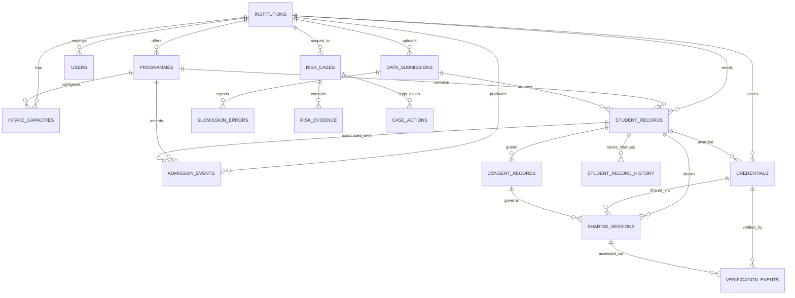

# Database Schema Reference — APAAR Nexus (SIH PS 26263)

> Prototype Notice: All data in APAAR Nexus is synthetic. This database does not connect to live government systems.

---

## 1. Schema Design Principles

1. **Primary Keys:** Every internal primary key is a UUIDv4 string (`CHAR(36)`), generated via `uuid.uuid4()`.
2. **Foreign Keys:** SQLite foreign key constraint enforcement is enabled at connection time via `PRAGMA foreign_keys=ON;`.
3. **APAAR Handling:** `apaar_ref` is stored as an **external identifier** column in `student_records`. It is indexed for fast lookup but is **deliberately NOT unique** and never used as a primary key. This allows the system to store, detect, and investigate duplicate or conflicting APAAR identities across institutions.
4. **Investigation Signals:** `contact_ref` (phone/email hash) and `fee_payer_ref` are indexed but **deliberately NOT unique** (siblings and sponsors legitimately share them).
5. **Security & Privacy:**
   - User passwords are stored as Werkzeug hashes (`password_hash`).
   - Signing keys store public keys only (`public_key_pem`); private keys remain on the filesystem/HSM and are never stored in the database.
   - Sharing session tokens store only a SHA-256 hash (`token_hash`) with a 6-character prefix (`token_prefix`) for identification.

---

## 2. Entity Relationship Diagram (ERD)

---

## 3. Table Catalog

### Core & Authentication

#### `users`
System user accounts with role-based access control and institution scoping.
| Column | Type | Constraints | Description |
|---|---|---|---|
| `id` | VARCHAR(36) | PK, default UUID | Internal user identifier |
| `username` | VARCHAR(80) | UNIQUE, NOT NULL, INDEX | Login username (e.g. `AICTE_Admin`, `VESIT`) |
| `password_hash` | VARCHAR(255) | NOT NULL | Werkzeug-generated password hash |
| `full_name` | VARCHAR(120) | NOT NULL | Display name |
| `role` | VARCHAR(30) | NOT NULL, INDEX | Role enum (`AICTE_ADMIN`, `INSTITUTION_ADMIN`, `STUDENT`, `VERIFIER`, `AUDITOR`) |
| `institution_id` | VARCHAR(36) | FK(institutions.id), NULLABLE | Institution scope for `INSTITUTION_ADMIN` |
| `student_id` | VARCHAR(36) | FK(student_records.id), NULLABLE | Student scope for `STUDENT` |
| `is_active` | BOOLEAN | NOT NULL, DEFAULT TRUE | Account active flag |
| `created_at` | DATETIME | NOT NULL | Record creation timestamp |
| `updated_at` | DATETIME | NOT NULL | Last update timestamp |

---

### Institutions & Programmes (Seat Ledger Infrastructure)

#### `institutions`
AICTE-approved educational institutions participating in APAAR Nexus.
| Column | Type | Constraints | Description |
|---|---|---|---|
| `id` | VARCHAR(36) | PK, default UUID | Internal institution identifier |
| `code` | VARCHAR(30) | UNIQUE, NOT NULL, INDEX | Short institutional code (e.g. `VESIT`, `COEP`, `VJTI`) |
| `name` | VARCHAR(255) | NOT NULL | Full name of institution |
| `state` | VARCHAR(100) | NOT NULL | State location |
| `city` | VARCHAR(100) | NOT NULL | City location |
| `is_synthetic` | BOOLEAN | NOT NULL, DEFAULT TRUE | Prototype synthetic marker |
| `status` | VARCHAR(30) | NOT NULL, DEFAULT 'ACTIVE' | Operational status |
| `created_at` | DATETIME | NOT NULL | Timestamp |
| `updated_at` | DATETIME | NOT NULL | Timestamp |

#### `programmes`
Degree programmes offered by institutions.
| Column | Type | Constraints | Description |
|---|---|---|---|
| `id` | VARCHAR(36) | PK, default UUID | Programme identifier |
| `institution_id` | VARCHAR(36) | FK(institutions.id), NOT NULL | Offering institution |
| `code` | VARCHAR(50) | NOT NULL, INDEX | Programme code (e.g. `BTECH-IT`) |
| `name` | VARCHAR(255) | NOT NULL | Full programme title |
| `level` | VARCHAR(20) | NOT NULL, DEFAULT 'UG' | Academic level (`UG`, `PG`, `DIPLOMA`) |
| `created_at` | DATETIME | NOT NULL | Timestamp |
| `updated_at` | DATETIME | NOT NULL | Timestamp |
*Unique constraint: `(institution_id, code)`*

#### `intake_capacities`
Approved intake limits and category allocation rules for Dynamic Seat Ledger.
| Column | Type | Constraints | Description |
|---|---|---|---|
| `id` | VARCHAR(36) | PK, default UUID | Capacity identifier |
| `institution_id` | VARCHAR(36) | FK(institutions.id), NOT NULL | Offering institution |
| `programme_id` | VARCHAR(36) | FK(programmes.id), NOT NULL | Academic programme |
| `academic_year` | VARCHAR(20) | NOT NULL, INDEX | Target year (e.g. `2026-27`) |
| `approved_regular_intake` | INTEGER | NOT NULL, DEFAULT 120 | Regular seat quota |
| `supernumerary_capacity` | INTEGER | NOT NULL, DEFAULT 10 | Supernumerary quota |
| `category_rules` | JSON | NULLABLE | JSON mapping of category eligibility |
| `created_at` | DATETIME | NOT NULL | Timestamp |
| `updated_at` | DATETIME | NOT NULL | Timestamp |
*Unique constraint: `(institution_id, programme_id, academic_year)`*

---

### Student Records & Lifecycle

#### `student_records`
Core academic student identities and admissions.
| Column | Type | Constraints | Description |
|---|---|---|---|
| `id` | VARCHAR(36) | PK, default UUID | Student record UUID |
| `institution_id` | VARCHAR(36) | FK(institutions.id), NOT NULL | Enrolling institution |
| `programme_id` | VARCHAR(36) | FK(programmes.id), NOT NULL | Academic programme |
| `institution_student_id` | VARCHAR(50) | NOT NULL | College roll/PRN number |
| `apaar_ref` | VARCHAR(20) | NULLABLE, INDEX | 12-digit APAAR reference (NOT unique) |
| `full_name` | VARCHAR(150) | NOT NULL | Student full legal name |
| `normalized_name` | VARCHAR(150) | NOT NULL, INDEX | Lowercase/stripped name for RapidFuzz |
| `academic_year` | VARCHAR(20) | NOT NULL, INDEX | Admission batch (e.g. `2026-27`) |
| `admission_date` | DATE | NOT NULL | Date of admission |
| `admission_category` | VARCHAR(30) | NOT NULL | Category enum (`OPEN`, `OBC`, `SC`, etc.) |
| `classification` | VARCHAR(30) | NOT NULL | Classification enum (`REGULAR`, `SUPERNUMERARY`) |
| `is_nri` | BOOLEAN | NOT NULL, DEFAULT FALSE | NRI applicant flag |
| `is_oci` | BOOLEAN | NOT NULL, DEFAULT FALSE | OCI applicant flag |
| `is_foreign_national` | BOOLEAN | NOT NULL, DEFAULT FALSE | Foreign National applicant flag |
| `enrolment_status` | VARCHAR(30) | NOT NULL, INDEX | `ACTIVE`, `WITHDRAWN`, `GRADUATED` |
| `validation_status` | VARCHAR(30) | NOT NULL, INDEX | `PENDING`, `VALID`, `INVALID`, `FLAGGED` |
| `validation_notes` | TEXT | NULLABLE | Validation service error/warning messages |
| `contact_ref` | VARCHAR(100) | NULLABLE, INDEX | Phone / email reference (signal, NOT unique) |
| `fee_payer_ref` | VARCHAR(100) | NULLABLE, INDEX | Sponsor / fee reference (signal, NOT unique) |
| `source_submission_id` | VARCHAR(36) | FK(data_submissions.id), NULLABLE | Originating CSV batch ID |
| `is_synthetic` | BOOLEAN | NOT NULL, DEFAULT TRUE | Synthetic marker |
| `created_at` | DATETIME | NOT NULL | Timestamp |
| `updated_at` | DATETIME | NOT NULL | Timestamp |
*Unique constraint: `(institution_id, institution_student_id, academic_year)`*

#### `student_record_history`
Granular field-level change history for all student record updates.
| Column | Type | Constraints | Description |
|---|---|---|---|
| `id` | VARCHAR(36) | PK, default UUID | History entry identifier |
| `student_id` | VARCHAR(36) | FK(student_records.id), NOT NULL | Modified student record |
| `changed_by` | VARCHAR(80) | NOT NULL | Actor username |
| `changed_at` | DATETIME | NOT NULL, INDEX | Timestamp of change |
| `field` | VARCHAR(50) | NOT NULL | Modified column name |
| `old_value` | TEXT | NULLABLE | Pre-update value |
| `new_value` | TEXT | NULLABLE | Post-update value |
| `reason` | VARCHAR(255) | NULLABLE | Justification / ticket reference |

---

### Admissions & Data Submissions

#### `admission_events`
Ledger of every admission request processed by the Seat Ledger.
| Column | Type | Constraints | Description |
|---|---|---|---|
| `id` | VARCHAR(36) | PK, default UUID | Event identifier |
| `institution_id` | VARCHAR(36) | FK(institutions.id), NOT NULL | Target institution |
| `programme_id` | VARCHAR(36) | FK(programmes.id), NOT NULL | Target programme |
| `academic_year` | VARCHAR(20) | NOT NULL, INDEX | Target academic year |
| `student_id` | VARCHAR(36) | FK(student_records.id), NULLABLE | Enrolled student ID (if accepted) |
| `category` | VARCHAR(30) | NOT NULL | Category enum |
| `classification` | VARCHAR(30) | NOT NULL | `REGULAR` or `SUPERNUMERARY` |
| `result` | VARCHAR(30) | NOT NULL, INDEX | `ACCEPTED` or `REJECTED` |
| `reason_code` | VARCHAR(50) | NOT NULL | `APPROVED`, `CAPACITY_EXCEEDED`, etc. |
| `message` | TEXT | NULLABLE | Explanation of decision |
| `actor_id` | VARCHAR(80) | NOT NULL | Username of registrar / admin |
| `created_at` | DATETIME | NOT NULL, INDEX | Event timestamp |

#### `data_submissions`
Batch CSV upload manifests with idempotency tracking.
| Column | Type | Constraints | Description |
|---|---|---|---|
| `id` | VARCHAR(36) | PK, default UUID | Submission identifier |
| `reference` | VARCHAR(50) | UNIQUE, NOT NULL, INDEX | Human reference (`SUB-YYYYMMDD-XXXXXX`) |
| `institution_id` | VARCHAR(36) | FK(institutions.id), NOT NULL | Uploading institution |
| `uploaded_by` | VARCHAR(80) | NOT NULL | Admin username |
| `filename` | VARCHAR(255) | NOT NULL | Uploaded file name |
| `file_sha256` | VARCHAR(64) | NOT NULL, INDEX | SHA-256 file hash for idempotent deduping |
| `status` | VARCHAR(30) | NOT NULL, INDEX | `PREVIEWED`, `COMMITTED`, `PARTIAL`, `REJECTED` |
| `total_rows` | INTEGER | NOT NULL, DEFAULT 0 | Row count in file |
| `valid_rows` | INTEGER | NOT NULL, DEFAULT 0 | Count of rows passing checks |
| `error_rows` | INTEGER | NOT NULL, DEFAULT 0 | Count of rows failing checks |
| `created_at` | DATETIME | NOT NULL | Upload timestamp |
| `committed_at` | DATETIME | NULLABLE | Commit timestamp |
*Unique constraint: `(institution_id, file_sha256)`*

#### `submission_errors`
Row-by-row validation failures from CSV processing.
| Column | Type | Constraints | Description |
|---|---|---|---|
| `id` | VARCHAR(36) | PK, default UUID | Error record identifier |
| `submission_id` | VARCHAR(36) | FK(data_submissions.id), NOT NULL | Associated submission |
| `row_number` | INTEGER | NOT NULL | CSV row index (1-based) |
| `field` | VARCHAR(50) | NULLABLE | Offending column name |
| `code` | VARCHAR(50) | NOT NULL | Standard error code |
| `message` | TEXT | NOT NULL | Human-readable explanation |
| `raw_row` | JSON | NULLABLE | Original CSV row values |

---

### Identity Resolution & Risk Engine

#### `identity_matches`
Discovered pairwise identity matches across students.
| Column | Type | Constraints | Description |
|---|---|---|---|
| `id` | VARCHAR(36) | PK, default UUID | Match identifier |
| `student_a_id` | VARCHAR(36) | FK(student_records.id), NOT NULL | First student |
| `student_b_id` | VARCHAR(36) | FK(student_records.id), NOT NULL | Second student |
| `match_type` | VARCHAR(50) | NOT NULL, INDEX | Match type (e.g. `EXACT_APAAR`, `SIMILAR_NAME`) |
| `confidence` | FLOAT | NOT NULL, DEFAULT 1.0 | RapidFuzz similarity score (0.0–1.0) |
| `evidence` | JSON | NULLABLE | Matching attributes and rationale |
| `scan_id` | VARCHAR(50) | NOT NULL, INDEX | Identity resolution run identifier |
| `event_key` | VARCHAR(100) | NOT NULL, INDEX | Deduplication key |
*Unique constraint: `(scan_id, event_key)`*

#### `identity_graph_edges`
Graph edges for Cytoscape.js identity conflict visualization.
| Column | Type | Constraints | Description |
|---|---|---|---|
| `id` | VARCHAR(36) | PK, default UUID | Edge identifier |
| `source_type` | VARCHAR(30) | NOT NULL | Node type (`STUDENT`, `INSTITUTION`) |
| `source_id` | VARCHAR(50) | NOT NULL, INDEX | Source entity UUID |
| `target_type` | VARCHAR(30) | NOT NULL | Node type (`STUDENT`, `INSTITUTION`) |
| `target_id` | VARCHAR(50) | NOT NULL, INDEX | Target entity UUID |
| `edge_type` | VARCHAR(50) | NOT NULL, INDEX | Edge classification (`CONFLICT`, `SHARED_CONTACT`) |
| `explanation` | TEXT | NOT NULL | Plain-English explanation of link |
| `evidence` | JSON | NULLABLE | Raw evidence payload |
| `created_at` | DATETIME | NOT NULL | Timestamp |
| `updated_at` | DATETIME | NOT NULL | Timestamp |

#### `risk_cases`
Investigation cases created by the explainable risk engine.
| Column | Type | Constraints | Description |
|---|---|---|---|
| `id` | VARCHAR(36) | PK, default UUID | Case identifier |
| `reference` | VARCHAR(30) | UNIQUE, NOT NULL, INDEX | Human reference (`CASE-XXXXXX`) |
| `institution_id` | VARCHAR(36) | FK(institutions.id), NULLABLE | Scoped institution |
| `score` | INTEGER | NOT NULL, DEFAULT 0 | Additive risk score (capped at 100) |
| `severity` | VARCHAR(20) | NOT NULL, INDEX | Severity enum (`LOW`, `MEDIUM`, `HIGH`, `CRITICAL`) |
| `status` | VARCHAR(30) | NOT NULL, INDEX | Workflow status (`OPEN`, `UNDER_REVIEW`, etc.) |
| `assigned_to` | VARCHAR(80) | NULLABLE, INDEX | Assigned investigator username |
| `recommended_action`| VARCHAR(255) | NULLABLE | Recommended review step |
| `summary` | TEXT | NULLABLE | Narrative summary of findings |
| `opened_at` | DATETIME | NOT NULL | Case creation timestamp |
| `updated_at` | DATETIME | NOT NULL | Last update timestamp |

#### `risk_evidence`
Rule breakdown contributing to a risk case score.
| Column | Type | Constraints | Description |
|---|---|---|---|
| `id` | VARCHAR(36) | PK, default UUID | Evidence identifier |
| `case_id` | VARCHAR(36) | FK(risk_cases.id), NOT NULL | Target case |
| `rule_key` | VARCHAR(50) | NOT NULL, INDEX | Triggered rule (`DUPLICATE_APAAR`, etc.) |
| `points` | INTEGER | NOT NULL, DEFAULT 0 | Weighted points awarded |
| `event_key` | VARCHAR(100) | NOT NULL | Unique event key (prevents double-counting) |
| `description` | TEXT | NOT NULL | Human-readable explanation of rule hit |
| `related_student_ids`| JSON | NULLABLE | Involved student UUIDs |
| `details` | JSON | NULLABLE | Contextual metadata |
*Unique constraint: `(case_id, event_key)`*

#### `case_actions`
Audit log of review actions taken by investigators on risk cases.
| Column | Type | Constraints | Description |
|---|---|---|---|
| `id` | VARCHAR(36) | PK, default UUID | Action identifier |
| `case_id` | VARCHAR(36) | FK(risk_cases.id), NOT NULL | Reviewed case |
| `actor_id` | VARCHAR(80) | NOT NULL | Reviewer username |
| `action` | VARCHAR(40) | NOT NULL | Action type enum (`UNDER_REVIEW`, `RESOLVE`, etc.) |
| `from_status` | VARCHAR(30) | NOT NULL | Prior status |
| `to_status` | VARCHAR(30) | NOT NULL | New status |
| `note` | TEXT | NULLABLE | Reviewer comments / justification |
| `created_at` | DATETIME | NOT NULL, INDEX | Timestamp |

---

### Academic Passport & Verification

#### `credentials`
Ed25519 digitally signed academic credentials.
| Column | Type | Constraints | Description |
|---|---|---|---|
| `id` | VARCHAR(36) | PK, default UUID | Credential identifier |
| `reference` | VARCHAR(30) | UNIQUE, NOT NULL, INDEX | Human reference (`CRED-XXXXXX`) |
| `student_id` | VARCHAR(36) | FK(student_records.id), NOT NULL | Awarded student |
| `institution_id` | VARCHAR(36) | FK(institutions.id), NOT NULL | Issuing institution |
| `programme_name` | VARCHAR(255) | NOT NULL | Awarded degree title |
| `award_year` | VARCHAR(20) | NOT NULL | Graduation batch year |
| `issue_date` | DATE | NOT NULL | Date of credential issuance |
| `expires_at` | DATETIME | NULLABLE | Optional expiration timestamp |
| `payload_json` | TEXT | NOT NULL | Canonical JSON string that was signed |
| `signature` | TEXT | NOT NULL | Base64-encoded Ed25519 signature |
| `key_id` | VARCHAR(50) | NOT NULL, INDEX | Signing key identifier |
| `status_stored` | VARCHAR(30) | NOT NULL, INDEX | `ISSUED` or `REVOKED` |
| `revoked_at` | DATETIME | NULLABLE | Revocation timestamp |
| `revoked_by` | VARCHAR(80) | NULLABLE | Actor who revoked credential |
| `revoke_reason` | TEXT | NULLABLE | Justification for revocation |
| `created_at` | DATETIME | NOT NULL | Timestamp |
| `updated_at` | DATETIME | NOT NULL | Timestamp |

#### `signing_keys`
Public key registry for Ed25519 verification.
| Column | Type | Constraints | Description |
|---|---|---|---|
| `id` | VARCHAR(36) | PK, default UUID | Key record identifier |
| `key_id` | VARCHAR(50) | UNIQUE, NOT NULL, INDEX | Key identifier (e.g. `KEY-2026-DEV-01`) |
| `public_key_pem` | TEXT | NOT NULL | PEM-encoded Ed25519 public key |
| `algorithm` | VARCHAR(30) | NOT NULL, DEFAULT 'Ed25519'| Signing algorithm |
| `created_at` | DATETIME | NOT NULL | Timestamp |
| `is_active` | BOOLEAN | NOT NULL, DEFAULT TRUE | Active verification status |
| `is_development_key`| BOOLEAN | NOT NULL, DEFAULT TRUE | Prototype development key flag |

#### `consent_records`
Student authorization record specifying allowed disclosure claims.
| Column | Type | Constraints | Description |
|---|---|---|---|
| `id` | VARCHAR(36) | PK, default UUID | Consent identifier |
| `student_id` | VARCHAR(36) | FK(student_records.id), NOT NULL | Authorizing student |
| `claims` | JSON | NOT NULL | Array of permitted `SharingClaim` enums |
| `created_at` | DATETIME | NOT NULL | Timestamp |

#### `sharing_sessions`
Time-limited, tokenized credential sharing links.
| Column | Type | Constraints | Description |
|---|---|---|---|
| `id` | VARCHAR(36) | PK, default UUID | Session identifier |
| `student_id` | VARCHAR(36) | FK(student_records.id), NOT NULL | Sharing student |
| `credential_id` | VARCHAR(36) | FK(credentials.id), NOT NULL | Shared credential |
| `consent_id` | VARCHAR(36) | FK(consent_records.id), NOT NULL | Governing consent record |
| `token_hash` | VARCHAR(64) | UNIQUE, NOT NULL, INDEX | SHA-256 hash of random access token |
| `token_prefix` | VARCHAR(10) | NOT NULL | First 6 chars of token for lookup/display |
| `claims` | JSON | NOT NULL | Selected claims allowed for this session |
| `expires_at` | DATETIME | NOT NULL, INDEX | Session expiration datetime |
| `revoked_at` | DATETIME | NULLABLE | Early revocation datetime |
| `created_at` | DATETIME | NOT NULL | Timestamp |
| `access_count` | INTEGER | NOT NULL, DEFAULT 0 | Times accessed by third parties |
| `last_accessed_at` | DATETIME | NULLABLE | Most recent access timestamp |

#### `verification_events`
Audit log of all public QR scans and shared link verification checks.
| Column | Type | Constraints | Description |
|---|---|---|---|
| `id` | VARCHAR(36) | PK, default UUID | Event identifier |
| `credential_id` | VARCHAR(36) | FK(credentials.id), NULLABLE | Verified credential ID |
| `sharing_session_id`| VARCHAR(36) | FK(sharing_sessions.id), NULLABLE| Associated sharing session |
| `result` | VARCHAR(30) | NOT NULL, INDEX | Result enum (`VERIFIED`, `INVALID`, `REVOKED`, `EXPIRED`) |
| `verifier_user_id` | VARCHAR(36) | NULLABLE | Logged-in verifier (if authenticated) |
| `ip_hash` | VARCHAR(64) | NULLABLE | Salted hash of client IP |
| `created_at` | DATETIME | NOT NULL, INDEX | Verification timestamp |

---

### Audit Trail & System Configuration

#### `audit_logs`
Append-only log of every mutating action across all modules.
| Column | Type | Constraints | Description |
|---|---|---|---|
| `id` | VARCHAR(36) | PK, default UUID | Audit log identifier |
| `actor_id` | VARCHAR(80) | NOT NULL, INDEX | Username or system actor |
| `actor_role` | VARCHAR(30) | NULLABLE | Actor role at time of action |
| `action` | VARCHAR(50) | NOT NULL, INDEX | Action enum (e.g. `ADMISSION_ACCEPTED`) |
| `entity_type` | VARCHAR(50) | NOT NULL, INDEX | Entity type (`STUDENT`, `CREDENTIAL`, etc.) |
| `entity_id` | VARCHAR(50) | NOT NULL, INDEX | Target entity identifier |
| `institution_id` | VARCHAR(36) | NULLABLE, INDEX | Scoped institution |
| `details` | JSON | NULLABLE | Sanitized context payload (no secrets) |
| `created_at` | DATETIME | NOT NULL, INDEX | Event timestamp |

#### `system_policies`
Dynamic system rules, risk scoring weights, and validation parameters.
| Column | Type | Constraints | Description |
|---|---|---|---|
| `id` | VARCHAR(36) | PK, default UUID | Policy entry identifier |
| `key` | VARCHAR(80) | UNIQUE, NOT NULL, INDEX | Configuration key (e.g. `risk_weights`, `apaar_regex`) |
| `value` | JSON | NOT NULL | Config payload |
| `description` | TEXT | NULLABLE | Administrative documentation |
| `updated_by` | VARCHAR(80) | NOT NULL, DEFAULT 'SYSTEM' | Last updater |
| `updated_at` | DATETIME | NOT NULL | Last update timestamp |
